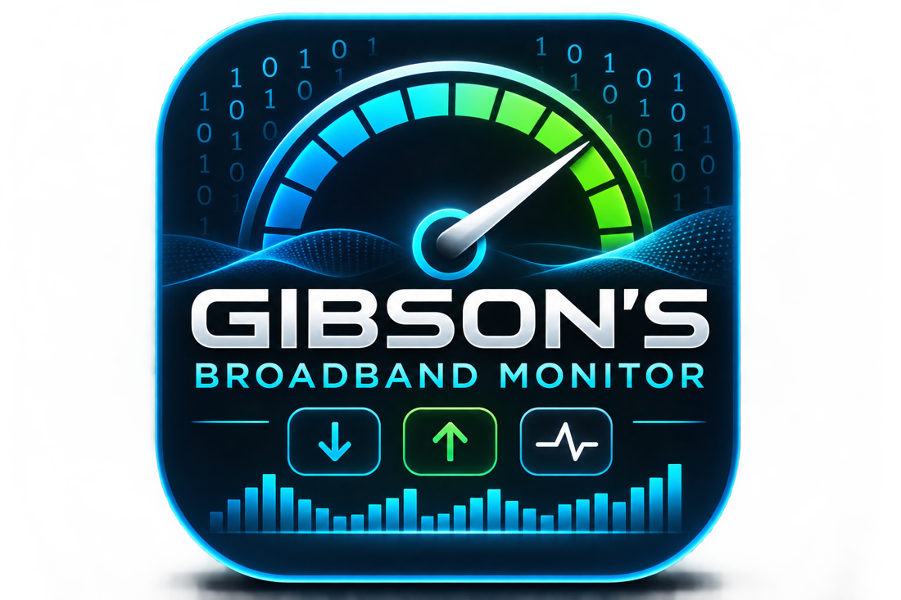

# Gibson's Broadband Monitor

[](https://github.com/users/gibbo1973/packages/container/package/gibsons-broadband-monitor)

*Docker pulls are image downloads/updates, not a count of unique users. The badge is provided by a third-party GHCR statistics service and may lag or be temporarily unavailable.*



**Beautiful, lightweight, self-hosted broadband monitoring.** A simple Unraid/Docker dashboard with digital readings, smooth historical speed graphs, latency tracking, real connection checks, unlimited local history and CSV export.

> **Public beta:** The Docker image is published at `ghcr.io/gibbo1973/gibsons-broadband-monitor:latest` and has been tested on Unraid. Community Applications listing is pending review. This is early software; test speeds against another reference and report issues.

## What's included

- Clean responsive navy dashboard, cyan download and mint upload readings, purple ping readings
- Smooth **monotone curved** time-series charts: no invented peaks, and failed tests break chart lines
- 24h, 7d, 30d, 90d, 1y, all-time and custom date ranges
- Hourly full speed tests by default, powered by [speedtest-go](https://github.com/showwin/speedtest-go) v1.8.3
- Lightweight dual-endpoint HTTPS availability tests every 30 seconds
- Outage start/end detection with two consecutive failures required to begin an event
- 30-day uptime and outage totals (based on probe samples)
- SQLite storage in `/data`, with no automatic deletion
- Recent test and outage tables; export all speed-test results as CSV
- Adjustable test interval and low-speed warning threshold from the UI
- Optional password for dashboard access; no external account or analytics service
- Separate icon.svg/icon.png for small icons and original chosen brand graphic in `brand.png`

**Requirements:** Docker (or Unraid with Docker), internet connectivity, and storage for the SQLite database. Builds for amd64 and arm64 with the supplied Dockerfile.

## Install on Unraid (prebuilt image)

Use the Unraid **Docker > Add Container** interface (no local image build required), or import the prepared template in `unraid/gibsons-broadband-monitor.xml`.

- **Name:** `gibsons-broadband-monitor`
- **Repository:** `ghcr.io/gibbo1973/gibsons-broadband-monitor:latest`
- **Network:** `bridge`; **Privileged:** off
- **Port:** host `8765` -> container `8765/tcp`
- **Persistent app data:** host `/mnt/user/appdata/gibsons-broadband-monitor` -> container `/data` (read/write)
- **Environment:** `TZ=Europe/London` (change timezone as appropriate)
- **WebUI:** `http://[IP]:[PORT:8765]/`

Open `http://YOUR-UNRAID-IP:8765`. The first speed test runs soon after startup. Graphs build up with actual test history. A different free **host** port can be used if 8765 is occupied.

For any public or remote access, set `DASHBOARD_PASSWORD` and a long random `SECRET_KEY`, and use HTTPS through a secure reverse proxy. Keep the dashboard on a trusted private network by default.

Update the image through Unraid Docker's **Check for Updates**. The `/data` mapping preserves measurements across container updates. Do not delete the appdata directory unless you intend to delete recorded results.

## Screenshots

A clean overview with large digital download/upload/latency readings, curved performance graphs, uptime stats and outage history. Screenshots will be added to this repository for the Community Applications listing.

## Docker Compose install

If Docker Compose is available on your host, from the project folder:

```sh
docker compose up -d --build
```

Compose persists the database in the Docker named volume `gbm-data`. Do not delete that volume if you want to retain historical data. This Compose example is for a local/LAN installation; set a dashboard password before remote access.

## Application configuration

| Variable | Default | Purpose |
| --- | --- | --- |
| `PORT` | `8765` | App listening port (Docker image starts Waitress on 8765) |
| `DATA_DIR` | `/data` | Persistent SQLite directory |
| `SPEED_INTERVAL_MINUTES` | `60` | Initial full speed-test interval (min 15, max 1440) |
| `PROBE_INTERVAL_SECONDS` | `30` | Initial availability-test interval (min 15, max 3600) |
| `SLOW_DOWNLOAD_MBPS` | `100` | Initial low-speed flag, editable in UI |
| `SPEEDTEST_SERVER_ID` | blank | Optional numerical speedtest.net server ID |
| `DASHBOARD_PASSWORD` | blank | Password protection for the dashboard/API |
| `SECRET_KEY` | random per start | Session cookie signing secret, recommended when password is set |
| `TZ` | `Europe/London` | Container timezone; displayed dates use the browser's local timezone |
| `LOG_LEVEL` | `INFO` | Logging verbosity |

UI changes are saved in SQLite and override the initial defaults. An already scheduled test may run once at its previous interval after you save new settings.

## How outages are measured

Each connectivity check attempts Google's `generate_204` HTTPS endpoint, then Cloudflare's diagnostic endpoint. If **both** are unreachable, that probe fails. Two consecutive failures open an outage event, and two consecutive successes close it. This reduces false alarms but isn't proof that your ISP itself was at fault: DNS, upstream services, or the monitor's host may be responsible.

The *ping* digital reading comes from the speedtest server and is different from the lightweight HTTPS probe response time. Tests use real traffic; frequent tests can consume a lot of data and temporarily affect other internet users. The recorded performance belongs to the selected third-party test server and can differ from the broadband line's nominal speed.

## Development & tests

```sh
python -m pip install -r requirements.txt
DISABLE_SCHEDULER=1 python -m unittest discover -s tests -v
node --check app/static/app.js
```

The `--json` output from `speedtest-go` includes `servers[0].dl_speed` and `.ul_speed` as bytes/second and `latency`/`jitter` in nanoseconds; the application converts them to Mbps and milliseconds. These are checked in tests with documented fixture-shaped records.

### Community Applications status

The source code is public, the image is built and public, and the Unraid template is prepared. The app has been tested on an Unraid server, but is **not yet listed in Community Applications**. The maintainer can submit the repository URL at [Unraid Community Apps submission](https://ca.unraid.net/submit/new), choose **Validate** then **Scan**, and complete the review. Listing approval is managed by Unraid; an image published on GHCR is not automatically listed.

The app is still a beta. Planned features include optional notifications, richer reporting and data import. Contributions and issue reports are welcome.

## Credits and licences

Gibson's Broadband Monitor is MIT licensed (see `LICENSE`). The broadband testing engine is the independent MIT-licensed [showwin/speedtest-go](https://github.com/showwin/speedtest-go), built from upstream during the Docker build. Flask and Waitress retain their respective licences. No third-party runtime CDN is needed for the dashboard.

